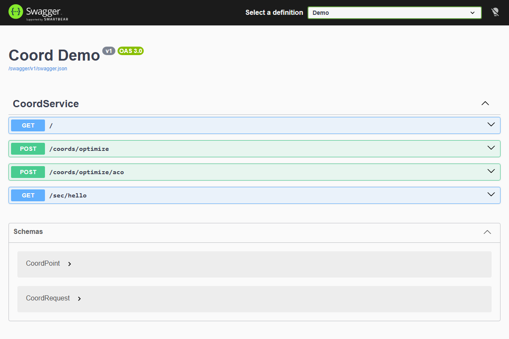
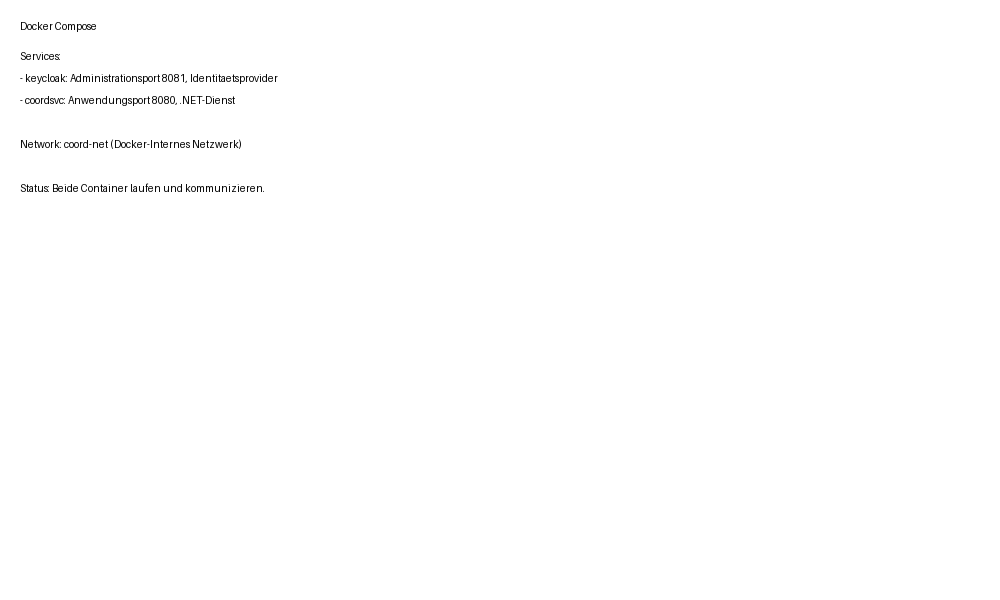

# 1. Introduction and Goals

## 1.1 Purpose

The CoordService Demo demonstrates a **Dockerized .NET microservice** that combines:
- **Authentication/Authorization** via **Keycloak** (OpenID Connect / OAuth 2.0)
- **Coordinate measurement path optimization** algorithms (Greedy Nearest-Neighbor + Ant Colony Optimization) inspired by Mitutoyo's **MiCAT Planner** software for CMM (Coordinate Measuring Machine) workflow automation.

This project serves as a technical reference implementation for C#/.NET developers exploring identity management and AI-based optimization in precision measurement domains.

## 1.2 Target Audience

- **C#/.NET developers** learning Keycloak integration in ASP.NET Core
- **Architects** evaluating .NET microservices with OIDC authentication
- **Technical recruits** preparing for Mitutoyo CTL (Coordinate Measuring Machine software development)
- **Measurement domain experts** prototyping CMM path optimization algorithms

## 1.3 System Overview

CoordService is a **Minimal API** web service that:
1. Validates JWT tokens issued by a Keycloak identity provider
2. Provides REST endpoints for optimizing measurement probe paths
3. Demonstrates two algorithms:
   - **Greedy Nearest Neighbor** — Fast, simple baseline
   - **Ant Colony Optimization** — Metaheuristic for globally optimal paths

## 1.4 Goals

| # | Goal | Priority | Status |
|---|---|---|---|
| G01 | Provide working Keycloak OIDC integration | MUST | ✅ |
| G02 | Implement coordinate path optimization | MUST | ✅ |
| G03 | Docker-based deployment | MUST | ✅ |
| G04 | Include ACO (Ameisenalgorithmus) | MUST | ✅ |
| G05 | Unit test coverage for algorithms | SHOULD | ✅ (6 tests) |
| G06 | Swagger API documentation | SHOULD | ✅ |

## 1.5 Non-Goals

- Production-grade security hardening
- Persistence layer (data is in-memory)
- WPF desktop GUI (API-only for container compatibility)
- Enterprise-scale load balancing

---

**Screenshot: Swagger UI Endpoints**

*Figure 1: POST /coords/optimize and /coords/optimize/aco endpoints*

---

**Screenshot: Docker Compose Services**

*Figure 2: Keycloak + CoordService containers running*
