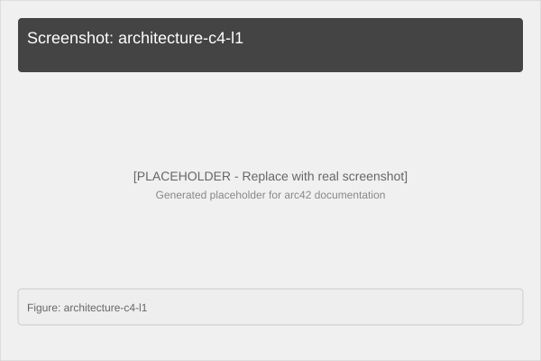

# 2. Architecture Overview

## 2.1 Architecture Diagram

```
┌─────────────────────────────────────────────────────────────────────┐
│                         CoordService Demo                            │
├─────────────────────────────────────────────────────────────────────┤
│                                                                      │
│  ┌─────────────────────┐    ┌─────────────────────────────────────┐ │
│  │     HTTP Layer      │    │        Business Logic               │ │
│  │   (Minimal API)     │───▶│   (PathOptimizer + ACO)             │ │
│  │  /coords/optimize   │    │                                     │ │
│  │  /coords/optimize/  │    │  CoordPoint[] → optimized int[]    │ │
│  │       aco           │    │                                     │ │
│  └─────────────────────┘    └─────────────────────────────────────┘ │
│           ▲                                                           │
│           │ JWKS endpoint                                             │
│           ▼                                                           │
│  ┌─────────────────────┐                                            │
│  │   Keycloak Auth     │                                            │
│  │   JWT Validation    │                                            │
│  └─────────────────────┘                                            │
│                                                                      │
└─────────────────────────────────────────────────────────────────────┘
            │                      │
            ▼                      ▼
        ┌───────┐              ┌─────────┐
        │ HTTP  │              │ Docker  │
        │ Client│              │ Compose │
        └───────┘              │+Keycloak│
                             └─────────┘
```

## 2.2 Architecture Style

- **Layered Architecture**: HTTP Layer → Business Logic Layer
- **Microservice Pattern**: Single-purpose service with clear boundaries
- **Stateless**: All computation is stateless per request
- **Cloud-Native**: Docker container based deployment
- **OIDC Security**: External identity provider (Keycloak) pattern

## 2.3 Technology Stack

| Category | Technology | Purpose |
|---|---|---|
| Runtime | .NET 10.0 | ASP.NET Core Minimal API |
| Auth | Keycloak 26.x + OIDC | Identity provider / JWT validation |
| Container | Docker + docker-compose | Multi-container orchestration |
| API Docs | Swashbuckle/Swagger | Interactive API documentation |
| Tests | xUnit | Unit testing |
| Build | dotnet CLI | Project compilation |

## 2.4 Top-Level Decomposition

```
CoordService Demo
├── src/CoordService/          # Main service
│   ├── Program.cs            # Entry Point + Endpoints
│   ├── PathOptimizer.cs      # Greedy NN algorithm
│   ├── z_AntColonyOptimizer.cs # ACO algorithm
│   └── Types.cs              # Domain types (CoordPoint, CoordRequest)
│
├── tests/CoordService.Tests/  # Unit tests
│   └── PathTests.cs          # 6 tests for both algorithms
│
├── Dockerfile                # Service container
├── docker-compose.yml        # Multi-service orchestration
└── docs/                     # arc42 documentation
```

---

**Architecture Diagram (C4 Level 1)**


*Figure: System context with Keycloak and HTTP clients*
