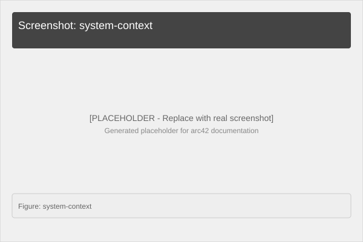
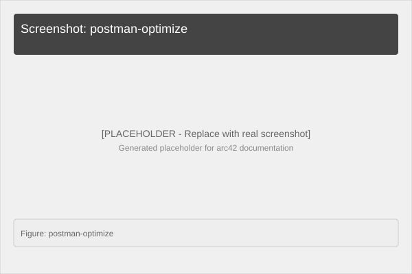

# 3. System Context

## 3.1 System Context Diagram (C4)

```
┌─────────────────────────────────────────────────────────────────────────────┐
│                              SYSTEM CONTEXT                                │
├─────────────────────────────────────────────────────────────────────────────┤
│                                                                      │
│                                 ┌─────────────┐                               │
│              Request JWT        │             │                               │
│              ┌──────────────────┼  Browser    │◄──────────────┐              │
│              │                  │  or cURL    │               │              │
│              ▼                  └──────┬──────┘               │              │
│   ┌──────────────────┐               │ cURL                 │              │
│   │                  │◄──────────────┘                      │              │
│   │  CoordService    │◄──────────────────────────────────────┘              │
│   │  (ASP.NET Core)  │                                               │
│   │                  │                                               │
│   │  8080: HTTP      │                                               │
│   │  /coords/optimize│                                               │
│   │  /coords/.../aco │                                               │
│   └──────────┬───────┘                                               │
│              │ token introspection                                      │
│              │ JWKS endpoint                                            │
│              ▼                                                         │
│   ┌──────────────────┐                                                 │
│   │     Keycloak     │                                                 │
│   │ Identity Provider│                                                 │
│   │  8081: HTTP      │                                                 │
│   │  Realm: measure  │                                                 │
│   │  Client: coord-  │                                                 │
│   │      service     │                                                 │
│   └──────────────────┘                                                 │
│                                                                      │
└─────────────────────────────────────────────────────────────────────────────┘
```

## 3.2 Stakeholders

| Role | Name | Expectations |
|---|---|---|
| Developer | Tobias Weiß | Clean C# code, Docker compatibility |
| Architect | System Designer | Reference implementation for OIDC + .NET |
| Recruiter | Karin Leier (Mitutoyo CTL) | Technical competence demonstration |
| Domain Expert | CMM Engineer | Meaningful measurement path algorithms |

## 3.3 Interfaces

| Interface | Type | Protocol | Direction |
|---|---|---|---|
| REST API | HTTP/JSON | HTTPS | Inbound |
| Keycloak OIDC | HTTP | HTTPS | Outbound |
| Docker Container | — | — | Deployment |

## 3.4 Actor Overview

| Actor | Description | Primary Interaction |
|---|---|---|
| **API Consumer** | Any HTTP client (browser, cURL, Postman) | POST coordinate arrays, get optimized paths |
| **Keycloak Admin** | Identity provider administrator | Configure realms, clients, users |
| **System Operator** | Person running the containers | `docker compose up/down` |
| **Software Developer** | Person extending the codebase | Edit files, run tests, push changes |

## 3.5 Context Relationships

- **CoordService ↔ API Consumer**: RESTful HTTP communication with JSON payloads
- **CoordService ↔ Keycloak**: OIDC-based authentication via JWT Bearer tokens
- **CoordService ↔ Docker**: Containerized deployment via docker-compose

---

**System Context Diagram (Visual)**


*Figure: C4 Level 1 - System context with users and systems* 

**Sequence: Single Optimized Request**

```
API Consumer    CoordService      Keycloak
     │               │               │
     │── POST optimize─▶│              │
     │               │               │
     │               │── validate JWT ──▶│ (optional, if secured)
     │               │◀── 200 OK ----------│
     │               │               │
     │◀── 200 {path,totalDistance} ──│              │
```

---

**Screenshot: Postman Request**


*Figure: Testing /coords/optimize endpoint with cURL/Postman*
