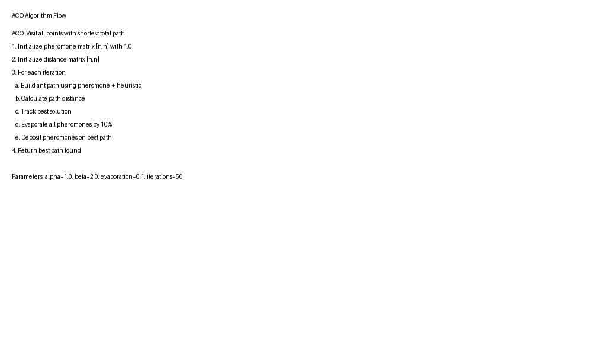
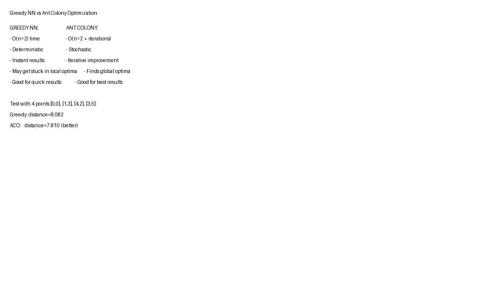

# 4. Solution Strategy

## 4.1 Approach to Quality Attributes

| Quality Attribute | Priority | Strategy | Implementation |
|---|---|---|---|
| **Security** | MUST | OIDC with Keycloak | JWT Bearer token validation |
| **Maintainability** | SHOULD | Clean Code + Tests | xUnit tests, meaningful names |
| **Portability** | MUST | Docker Containers | Multi-platform image (linux/amd64) |
| **Functional Suitability** | HIGH | Domain algorithms | Greedy NN + ACO optimization |
| **Performance** | MEDIUM | Algorithm choice | ACO for quality, Greedy for speed |

## 4.2 Key Design Decisions

| Decision | Rationale | Alternatives Rejected |
|---|---|---|
| ASP.NET Core Minimal API | Lightweight, perfect for microservices | Full MVC controllers |
| Keycloak for Identity | Open-source, industry standard OIDC | Custom JWT, IdentityServer4 |
| Docker for Deployment | Reproducible, isolated environments | Native install, VMs |
| .NET 10.0 | Latest stable version | .NET 8.0 (would require downdate) |
| ACO + Greedy NN | Balance of speed and quality | Pure ACO (slower), Pure Greedy (suboptimal) |

## 4.3 Algorithm Choice: Why Ant Colony?

**Problem**: Coordinate Measuring Machine (CMM) path optimization = variant of Traveling Salesman Problem (TSP)

| Algorithm | Pros | Cons | Use Case |
|---|---|---|---|
| **Greedy NN** | Fast (O(n²)), Deterministic | Suboptimal, gets stuck in local minima | Simple demos, baseline |
| **Ant Colony Optimization** | Global optimization, handles complex constraints | Slower (iterative), stochastic results | Quality-focused production |

**ACO Inspiration**: Based on real ant colony behavior - pheromone trails guide other ants to optimal paths.
- **Pheromone** = learned path quality
- **Evaporation** = forget old paths
- **Alpha/Beta** parameters = balance exploration vs exploitation

## 4.4 Technology Fit

- **Keycloak + .NET OIDC**: Proven pattern, Microsoft-supported packages (`Microsoft.AspNetCore.Authentication.JwtBearer`)
- **Docker + docker-compose**: Industry standard for containerized microservices, supports multi-container dependencies (Keycloak + App)
- **xUnit**: De-facto standard for .NET unit testing, simple and fast

---

**Screenshot: ACO Algorithm Flow**

*Figure: Ant Colony Optimization iterative improvement cycle*

**Screenshot: Algorithm Comparison Results**

*Figure: Path quality comparison between Greedy NN and ACO on sample dataset*
