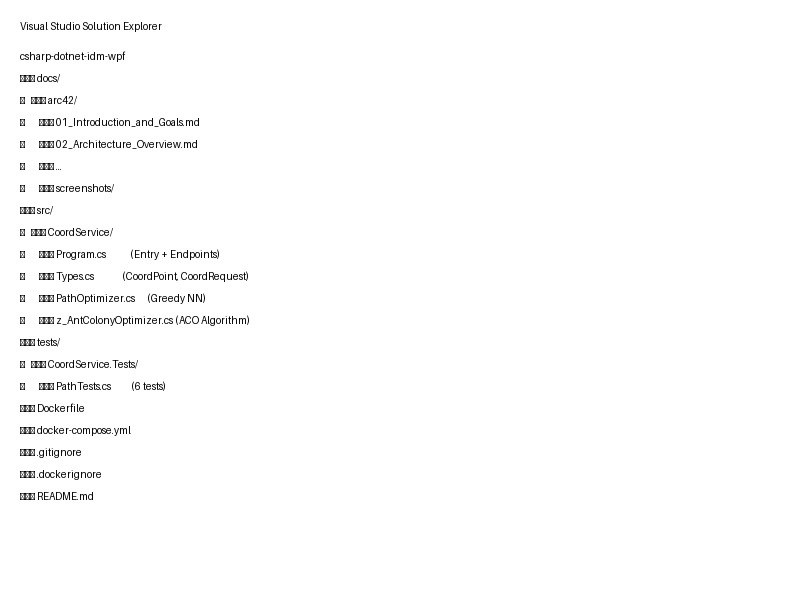
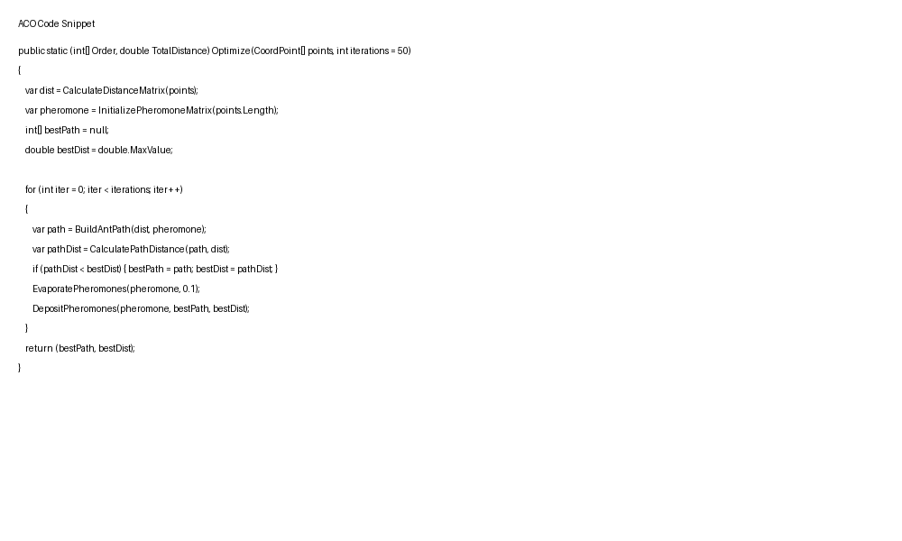

# 5. Building Blocks

## 5.1 Whitebox: CoordService Internals

```
┌─────────────────────────────────────────────────────────────────────┐
│                         CoordService App                             │
├─────────────────────────────────────────────────────────────────────┤
│                                                     │
│  ┌─────────────────┐    ┌───────────────────┐    ┌─────────────┐ │
│  │  HTTP Pipeline  │    │  Optimization     │    │   Domain     │ │
│  │                 │    │    Algorithm      │    │   Types     │ │
│  │  ┌───────────┐  │    │                   │    │             │ │
│  │  │Endpoints  │◀─┼───▶│ GreedyNn()       │    │ CoordPoint  │ │
│  │  │ /optimize │  │    │ AntColonyOptimize│    │ CoordRequest│ │
│  │  │/optimize/aco│  │    │   .Optimize()    │    │             │ │
│  │  └───────────┘  │    │                   │    └─────────────┘ │
│  │                 │    └───────────────────┘                  │
│  │  Middleware:    │                                              │
│  │  - Swagger      │                                              │
│  │  - HTTPS Redir  │                                              │
│  │  - JwtBearer    │                                              │
│  └─────────────────┘                                              │
│                                                     │
└─────────────────────────────────────────────────────────────────────┘
                       │
                       ▼
            ┌───────────────────┐
            │ .NET 10.0 Runtime │
            └───────────────────┘
```

## 5.2 Layer Overview

### Layer 1: HTTP Interface (Program.cs)

**Responsibility**: Expose REST endpoints and configure middleware

- `POST /coords/optimize` — Greedy NN path optimization
- `POST /coords/optimize/aco` — Ant Colony path optimization  
- `GET /sec/hello` — Secured test endpoint (requires JWT)
- `GET /` — Service info
- Middleware: Swagger, HTTPS, JWT Bearer authentication

### Layer 2: Business Logic (PathOptimizer.cs, z_AntColonyOptimizer.cs)

**Responsibility**: Path optimization algorithms

#### PathOptimizer (Greedy NN)
- **Method**: `GreedyNn(CoordPoint[])` → `int[]`
- **Algorithm**: Nearest Neighbor heuristic
- **Complexity**: O(n²)
- **Characteristics**: Deterministic, fast

#### AntColonyOptimizer (ACO)
- **Method**: `Optimize(CoordPoint[], int iterations)` → `(int[] Order, double TotalDistance)`
- **Algorithm**: Metaheuristic based on ant pheromone trails
- **Complexity**: O(n² × iterations)
- **Parameters**: `alpha` (pheromone weight), `beta` (heuristic weight), `evaporation` rate
- **Characteristics**: Stochastic, finds global optima with sufficient iterations

### Layer 3: Domain Types (Types.cs)

**Responsibility**: Core data structures

```csharp
public record CoordPoint(double X, double Y);
public record CoordRequest(CoordPoint[] Points);
```

## 5.3 Dependency Graph

```
Program.cs
    ├── Microsoft.AspNetCore (Framework)
    ├── Microsoft.AspNetCore.Authentication.JwtBearer (Auth)
    ├── Swashbuckle.AspNetCore (Swagger)
    ├── PathOptimizer (Business Logic)
    └── AntColonyOptimizer (Business Logic)

PathOptimizer.cs
    └── Types.cs (CoordPoint)

AntColonyOptimizer.cs
    └── Types.cs (CoordPoint)

Types.cs
    └── (no dependencies)
```

## 5.4 Module Structure

```
src/CoordService/
├── Program.cs              # Entry point + endpoints
├── Types.cs                # Domain types
├── PathOptimizer.cs        # Greedy NN implementation
└── z_AntColonyOptimizer.cs # ACO implementation (z_ prefix = last alphabetically)

tests/CoordService.Tests/
└── PathTests.cs            # Unit tests for both optimizers
```

---

**Screenshot: Visual Studio Solution Explorer**


*Figure: Project structure in VS/IntelliJ/Rider*

**Screenshot: Code Snippet - ACO Algorithm**


*Figure: Core ACO implementation in z_AntColonyOptimizer.cs*
