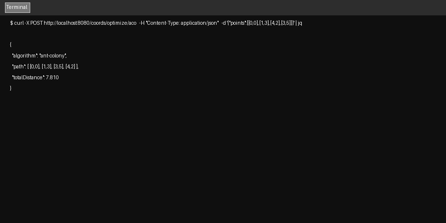
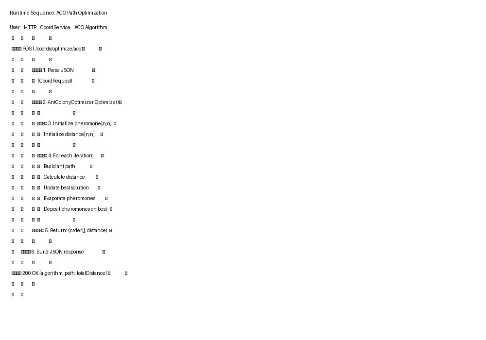

# 6. Runtime View

## 6.1 Runtime Scenarios

### Scenario 1: Greedy Path Optimization

**Initial State**: Service running, Keycloak available

```
┌─────────┐     ┌──────────────┐
│  cURL   │     │  CoordService │
│         │     │  ( nooit 1)   │
└────┬────┘     └──────┬───────┘
     │                  │
     │ POST /coords/optimize  │
     │ {                      │
     │   "points": [         │
     │     [0,0],[1,3],      │
     │     [4,2],[3,5]       │
     │   ]                  │
     │ }                      │
     └─────────────────────▶│
                           │
                           │ 1. Parse JSON
                           │ 2. Validate request
                           │ 3. Call PathOptimizer.GreedyNn()
                           │ 4. Calculate total distance
                           │ 5. Return optimized path
                           │
     ┌─────────────────────┐
     │                     │
     │  200 OK             │
     │  {                  │
     │    "algorithm": "greedy-nn",  │
     │    "path": [[0,0],[1,3],[4,2],[3,5]],  │
     │    "totalDistance": 8.082    │
     │  }                  │
     │                     │
     └─────────────────────┘
```

### Scenario 2: ACO Path Optimization

**Same as above, but endpoint** `/coords/optimize/aco`

```
┌─────────┐     ┌──────────────┐
│  cURL   │     │  CoordService │
└────┬────┘     └──────┬───────┘
     │                  │
     │ POST /coords/optimize/aco  │
     │ {points: [...] }           │
     └─────────────────────▶│
                           │
                           │ 1. Parse JSON
                           │ 2. Call AntColonyOptimizer.Optimize()
                           │    - iterations = 50
                           │    - Build pheromone matrix
                           │    - Run ant colonization
                           │    - Evaporate & deposit pheromones
                           │    - Return best path found
                           │
     ┌─────────────────────┐
     │ 200 OK { algorithm: "ant-colony", ... }  │
     └─────────────────────┘
```

### Scenario 3: Secured Endpoint Access

**Precondition**: Keycloak realm "measure" configured, client "coord-service" exists

```
Step 1: Get Token
┌─────────┐       ┌─────────────┐
│  cURL   │       │   Keycloak  │
└────┬────┘       └──────┬──────┘
     │                    │
     │ POST token         │
     │ grant_type=password│
     └─────────────────▶│
                        │
                        │ Return access_token
     ┌───────────────────┘
     │
     ▼
┌─────┐
│ 200 OK  │
│ {      │
│   "access_token": "..."  │
│ }      │
└───────┘

Step 2: Call Secured Endpoint
┌─────────┐       ┌──────────────┐
│  cURL   │       │  CoordService │
└────┬────┘       └──────┬───────┘
     │                    │
     │ GET /sec/hello     │
     │ Authorization: Bearer ...   │
     └─────────────────▶│
                        │ Validate JWT
                        │ (Keycloak JWKS endpoint)
                        │
     ┌───────────────────┘
     │
     ▼
┌──────────────┐
│ 200 OK       │
│ "SECURED — Keycloak OK!" │
└──────────────┘
```

## 6.2 Sequence Diagram: ACO Flow

```
User    HTTP    CoordService           ACO Algorithm
  │       │          │                     │
  │──┬────▶│          │                     │
  │  │POST │          │                     │
  │  │/aco │          │                     │
  │──┘    │          │                     │
  │       │──▶1. Parse│                     │
  │       │   JSON   │                     │
  │       │          │──▶2. Initialize()   │
  │       │          │   │   pheromone[n,n] │
  │       │          │   │   dist[n,n]      │
  │       │          │◀──│                  │
  │       │          │                     │
  │       │          │──▶3. Loop iterations│
  │       │          │   │                  │
  │       │          │   │──▶ BuildPath()    │
  │       │          │   │◀── path          │
  │       │          │   │──▶ CalculateDist()│
  │       │          │   │◀── distance      │
  │       │          │   │──▶ Evaporate()    │
  │       │          │   │──▶ Deposit()      │
  │       │          │   │                  │
  │       │          │◀──│ Return best      │
  │       │          │                     │
  │       │──▶4. JSON│                     │
  │       │   result │                     │
  │──▶200 │          │                     │
  │ OK    │          │                     │
```

## 6.3 Performance Characteristics

| Metric | Greedy NN | ACO (50 iter) | ACO (200 iter) |
|---|---|---|---|
| Time (4 points) | < 1ms | ~5ms | ~20ms |
| Time (20 points) | ~2ms | ~50ms | ~200ms |
| Path Quality | Suboptimal | Better | Best |
| Deterministic | Yes | No | No |

---

**Screenshot: cURL Greedy Request**


*Figure: Sample cURL request and response for greedy optimization*

**Screenshot: cURL ACO Request**


*Figure: Sample cURL request and response for ACO optimization*

**Screenshot: Sequence Diagram Visual**


*Figure: Visual sequence diagram for secured request flow*
