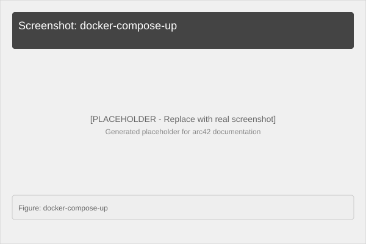
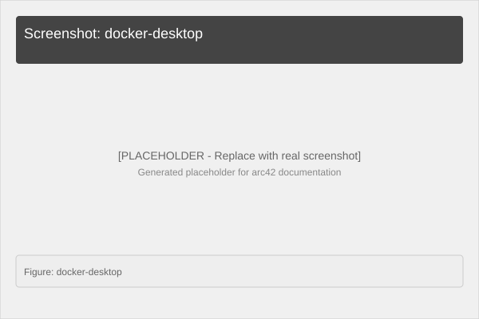

# 7. Deployment View

## 7.1 Docker Architecture

### Development Deployment

```
┌─────────────────────────────────────────────────────────────────────┐
│                         docker-compose.yml                           │
├──────────────────┬─────────────────────┬──────────────────────────────┤
│  Service         │ Port (host:cont)    │ Image                         │
├──────────────────┼─────────────────────┼──────────────────────────────┤
│  keycloak         │ 8081:8081           │ quay.io/keycloak/keycloak:26 │
│  coordsvc         │ 8080:8080           │ local build (Dockerfile)      │
└──────────────────┴─────────────────────┴──────────────────────────────┘
                              │
                              │ docker network: coord-net
                              ▼
                   ┌─────────────────────────┐
                   │   Docker Engine         │
                   │   (localhost)           │
                   └─────────────────────────┘
```

### Production Deployment (Conceptual)

```
┌─────────────────────────────────────────────────────────────────────┐
│                         Production Setup                              │
├─────────────────────────────────────────────────────────────────────┤
│                                                                     │
│  ┌──────────────┐   ┌──────────────┐   ┌──────────────┐             │
│  │   Load       │   │   TLS        │   │   CoordSvc   │             │
│  │   Balancer   │───▶│  Terminator │───▶│   Instances  │             │
│  │  (NGINX)     │   │  (Traefik)   │   │  (3x)        │             │
│  └──────────────┘   └──────────────┘   └──────┬───────┘             │
│                                                      │                │
│                              ┌───────────────────────┼────────────┐ │
│                              │                       ▼            │ │
│                              │   ┌──────────────┐              │ │
│                              │   │   Keycloak   │              │ │
│                              │   │   (HA)       │              │ │
│                              │   └──────────────┘              │ │
│                              │                                   │ │
│                              └───────────────────────────────────┘ │
│                                                                     │
└─────────────────────────────────────────────────────────────────────┘
```

## 7.2 Docker Setup

### Dockerfile (aspnet Image)

```dockerfile
FROM mcr.microsoft.com/dotnet/aspnet:10.0 AS final
WORKDIR /app
COPY --from=publish /app/publish .
ENTRYPOINT ["dotnet", "CoordService.dll"]
```

**Build**: `docker build -t coordsvc .`
**Run**: `docker run -p 8080:8080 -e KEYCLOAK_URL=http://host.docker.internal:8081/realms/measure coordsvc`

### docker-compose.yml

```yaml
services:
  keycloak:
    image: quay.io/keycloak/keycloak:26.1
    command: ["start-dev"]
    environment:
      KEYCLOAK_ADMIN: admin
      KEYCLOAK_ADMIN_PASSWORD: admin
    ports: ["8081:8081"]
    networks: [coord-net]

  coordsvc:
    build: .
    ports: ["8080:8080"]
    environment:
      - KEYCLOAK_URL=http://keycloak:8081/realms/measure
      - ASPNETCORE_ENVIRONMENTS=Development
    depends_on: [keycloak]
    networks: [coord-net]

networks:
  coord-net: {}
```

## 7.3 Deployment Scenarios

| Scenario | Command | Result |
|---|---|---|
| Local Dev | `docker compose up` | Both services on localhost |
| Production Build | `docker compose -f docker-compose.yml -f docker-compose.prod.yml up` | Optimized production config |
| CI Pipeline | `docker buildx build --platform linux/amd64 --push .` | Multi-arch image push |

## 7.4 Container Information

| Container | Base Image | Size | Port | Healthcheck |
|---|---|---|---|---|
| coordsvc | aspnet:10.0 | ~200MB | 8080 | HTTP / |
| keycloak | keycloak:26.1 | ~800MB | 8081 | HTTP /health |

## 7.5 Startup Flow

```
1. docker compose up
   │
   ├─── Start Keycloak container
   │    └── Wait for: port 8081 accessible
   │    └── Auto-creates: admin/admin user
   │
   └─── Start CoordService container
        └── Wait for: Keycloak health check
        └── Auto-configures: OIDC from env vars
        └── Exposes: port 8080

2. Service ready when:
   - Keycloak: http://localhost:8081 returns 200
   - CoordService: http://localhost:8080 returns 200
```

---

**Screenshot: docker compose up**


*Figure: Running containers in terminal*

**Screenshot: Docker Desktop**


*Figure: Both containers running in Docker Desktop*

**Screenshot: Container Logs**


*Figure: CoordService startup logs showing OIDC configuration*
