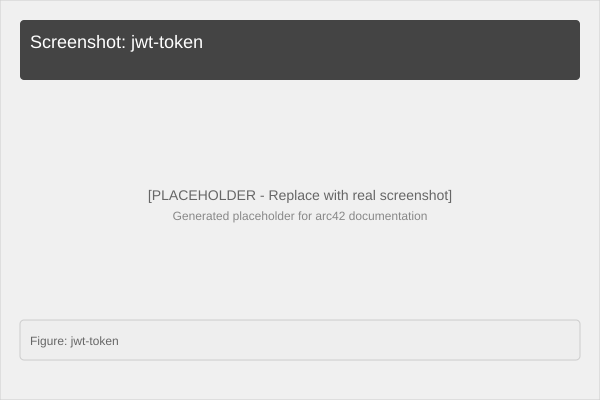
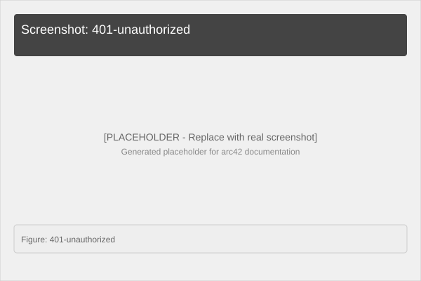

# 8. Cross-cutting Concepts

## 8.1 Authentication & Authorization

### Pattern: OpenID Connect with Keycloak

```
┌─────────────────────────┐
│   Authentication Flow    │
├─────────────────────────┤
│                         │
│  1. Client requests     │
│     /sec/hello          │
│     with Bearer token   │
│                         │
│  2. JwtBearer middleware│
│     intercepts request  │
│     extracts JWT        │
│                         │
│  3. Validates signature │
│     via Keycloak JWKS   │
│     endpoint             │
│                         │
│  4. Validates claims:   │
│     - iss (issuer)      │
│     - aud (audience)    │
│     - exp (expiration)  │
│                         │
│  5. If valid:           │
│     → continues to      │
│       endpoint handler  │
│     → sets User         │
│       on HttpContext    │
│                         │
└─────────────────────────┘
```

### Configuration

```csharp
// Program.cs
builder.Services.AddAuthentication(JwtBearerDefaults.AuthenticationScheme)
    .AddJwtBearer(opt =>
    {
        opt.Authority = "http://keycloak:8081/realms/measure";
        opt.TokenValidationParameters = new TokenValidationParameters
        {
            ValidateAudience = true,
            ValidAudience = "coord-service",
            ValidateIssuer = true
        };
    });
```

### Environment Variables

| Variable | Purpose | Default |
|---|---|---|
| `KEYCLOAK_URL` | Authority URL | `http://localhost:8081/realms/measure` |
| `KEYCLOAK_ISSUER` | Issuer validation | `http://localhost:8081/realms/measure` |
| `KEYCLOAK_AUDIENCE` | Audience validation | `coord-service` |

## 8.2 Error Handling

### Default Behavior
- **401 Unauthorized**: Missing or invalid JWT token
- **400 Bad Request**: Invalid JSON or malformed input
- **500 Internal Error**: Unexpected algorithm exception

### Middleware Pipeline
```
Request
   ▼
Swagger middleware (dev only)
   ▼
HTTPS Redirection
   ▼
JWT Bearer Authentication
   ▼
Authorization
   ▼
Endpoint Handler
   ▼
Response
```

## 8.3 Logging

### Console Logging (Development)
```csharp
// Automatic via ASP.NET Core
Console.WriteLine("[Auth] OK user: {user}");  // Custom in JwtBearer events
```

### Log Levels
- **Information**: Service startup, endpoint hits (development)
- **Warning**: Invalid requests, auth failures
- **Error**: Algorithm exceptions, config errors

## 8.4 Algorithm Selection

### Strategy Pattern via Endpoint Routing

```
┌─────────────────────────────────────┐
│  /coords/optimize      → GreedyNn  │
│  /coords/optimize/aco  → AntColony │
└─────────────────────────────────────┘
```

### When to Use Each

| Use Case | Recommended Algorithm | Reason |
|---|---|---|
| Quick demo | Greedy NN | Instant response (<1ms) |
| Simple data (<10 points) | Greedy NN | Good enough quality |
| Complex data (>10 points) | ACO | Better path quality |
| Production with time budget | ACO with iteration limit | Balance quality/speed |
| Benchmarking | Both | Compare results |

## 8.5 Data Model

### Core Types (Types.cs)

```csharp
// Immutable record - perfect for DTOs
public record CoordPoint(double X, double Y);

// Request wrapper
public record CoordRequest(CoordPoint[] Points);
```

### Coordinate Constraints
- **X, Y**: `double` values (no artificial limits)
- **Array Size**: 0-N points (empty array returns empty path)
- **Precision**: Standard .NET double precision (~15-17 digits)

---

**Screenshot: Keycloak Admin - Client Configuration**


*Figure: coord-service client in Keycloak Admin*

**Screenshot: JWT Token Structure**


*Figure: Decoded JWT showing standard OIDC claims (iss, aud, sub, exp)*

**Screenshot: Error Response**


*Figure: Missing token returns 401* (for secured endpoints when enabled)
