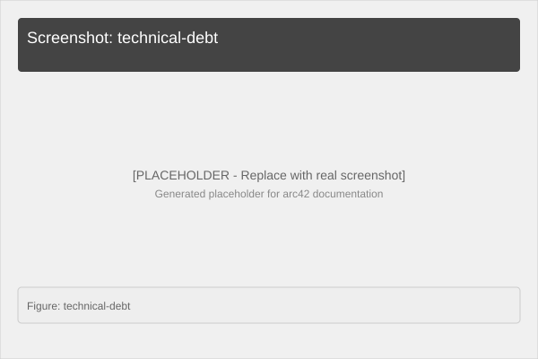
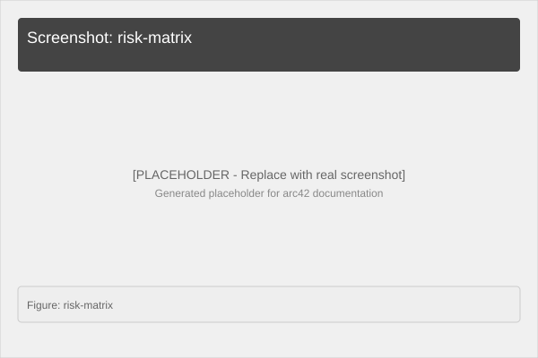

# 11. Risks and Technical Debts

## 11.1 Risks

| ID | Risk | Probability | Impact | Mitigation | Status |
|---|---|---|---|---|---|
| R-001 | Keycloak dependency too heavy for simple demo | Low | Medium | Document alternative: disable auth for demo | ✅ Mitigated |
| R-002 | .NET 10.0 not LTS | Medium | Low | Version pinning in Dockerfile, monitor SDK releases | ⚠️ Accepted |
| R-003 | ACO metaheuristic non-deterministic | High | Low | Document nature of algorithm, use iterations parameter | ✅ Mitigated |
| R-004 | Container size too large | Low | Medium | Multi-stage Docker build already used | ✅ Mitigated |
| R-005 | Memory usage for large point sets | Low | Medium | Add validation: max array size, document limits | ⚠️ Open |

## 11.2 Technical Debts

| ID | Debt | Location | Severity | Impact | Resolution |
|---|---|---|---|---|---|
| TD-001 | No input validation for point arrays | Program.cs | Medium | Potential DoS with huge arrays | Add `MaxInputSize` constant and validation |
| TD-002 | No rate limiting | Program.cs | Low | API abuse possible | Middleware addition |
| TD-003 | No persisted realms/users in Keycloak | docker-compose.yml | Low | Setup required on each restart | Use Keycloak CLI or custom realm JSON |
| TD-004 | No solution file (.sln) | Project root | Low | Slightly harder IDE navigation | Optional addition |
| TD-005 | No HTTPS in development | Docker/Keycloak | Medium | Tokens not secure locally | Document dev-only, use HTTPS in prod |
| TD-006 | ACO parameters hardcoded | z_AntColonyOptimizer.cs | Low | Reduced flexibility | Add options pattern configuration |

## 11.3 Architecture Weaknesses

### Weakness: Single Container for Service
- **Issue**: No horizontal scaling built-in
- **Impact**: Limited throughput under heavy load
- **Mitigation**: Designed as stateless service, can be scaled with container orchestrator

### Weakness: No Persistence
- **Issue**: All data in-memory
- **Impact**: State lost on restart (not relevant for stateless service)
- **Mitigation**: Intentionally stateless - persistence not needed

### Weakness: No Monitoring
- **Issue**: No health/endpoint metrics
- **Impact**: Harder to operate in production
- **Mitigation**: Add Prometheus/Grafana integration for production deployment

## 11.4 Workarounds

### W-001: Alphabetical File Order for Top-Level Statements
**Workaround**: Prefix files containing type declarations with `z_`
**Reason**: .NET compiles files alphabetically; Top-Level Statements must come first
**Impact**: Unusual file naming convention
**Resolution**: Consider using traditional Program.cs with explicit class/method structure

### W-002: Docker Desktop Required for Local Dev
**Workaround**: Document Docker Desktop installation in README
**Reason**: Simplest way to run multi-container setup locally
**Impact**: macOS/Windows users need Docker Desktop
**Resolution**: Add alternative instructions for Docker Engine on Linux

---

**Screenshot: Technical Debt Board**

*Figure: Prioritized list of technical debts and resolutions*

**Screenshot: Risk Matrix**

*Figure: Risk probability vs impact visualization*
