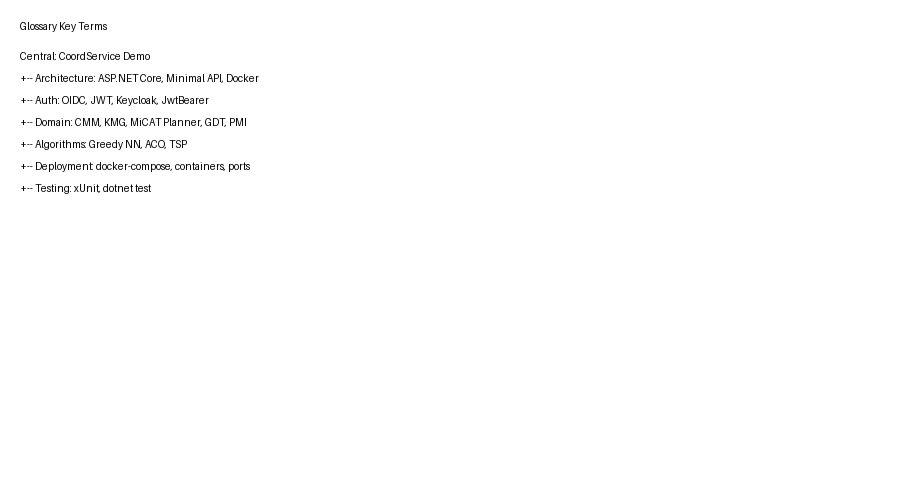

# 12. Glossary

## Architecture Terms

| Term | Definition | Related |
|---|---|---|
| **Minimal API** | Lightweight ASP.NET Core web API using top-level statements | Program.cs |
| **OIDC** | OpenID Connect - Identity layer on top of OAuth 2.0 | Keycloak, JWT |
| **JWT** | JSON Web Token - Compact, URL-safe token format | Bearer Auth |
| **JWKS** | JSON Web Key Set - Public keys for JWT signature verification | Keycloak |
| **JwtBearer** | ASP.NET Core middleware for JWT token validation | OIDC |

## Domain Terms

| Term | Definition | Related |
|---|---|---|
| **CMM** | Coordinate Measuring Machine - Device for dimensional measurement | MiCAT Planner |
| **KMG** | Koordinatenmessgerät - German for CMM | Mitutoyo |
| **MiCAT Planner** | Mitutoyo software for automated CMM part programming | Inspiration |
| **GD&T** | Geometric Dimensioning & Tolerancing - Engineering standard | CAD, PMI |
| **PMI** | Product and Manufacturing Information - 3D annotations | CAD, STEP AP242 |

## Algorithm Terms

| Term | Definition | Related |
|---|---|---|
| **TSP** | Traveling Salesman Problem - Visit all points, shortest path | Optimization |
| **Greedy NN** | Greedy Nearest Neighbor - Visit closest unvisited point | PathOptimizer |
| **ACO** | Ant Colony Optimization - Metaheuristic inspired by ants | AntColonyOptimizer |
| **Pheromone** | In ACO: Value representing learned path quality | ACO |
| **Evaporation** | In ACO: Reduction of pheromone over time | ACO |
| **Alpha/Beta** | In ACO: Parameters weighting pheromone vs heuristic | ACO |
| **Heuristic** | In ACO: 1/distance - preference for closer nodes | ACO |

## Technology Terms

| Term | Definition | Related |
|---|---|---|
| **Docker** | Container runtime platform | docker-compose.yml |
| **docker-compose** | Multi-container orchestration tool | Docker |
| **.NET 10.0** | Microsoft .NET runtime version 10.0 | SDK, Runtime |
| **ASP.NET Core** | Web framework for .NET | Minimal API |
| **Keycloak** | Open-source identity and access management | Auth |
| **Quarkus** | Java framework Keycloak is built on | Keycloak |
| **xUnit** | Unit testing framework for .NET | Tests |
| **Swashbuckle** | Swagger/OpenAPI support for .NET | Swagger UI |
| **Swagger UI** | Interactive API documentation | Swashbuckle |

## Source Code Terms

| Term | Definition | Related |
|---|---|---|
| **record** | C# immutable DTO type | Types.cs |
| **Top-Level Statements** | Code without explicit class/method | Program.cs |
| **Middleware** | Pipeline components in ASP.NET Core | UseXxx methods |

## File Terms

| Term | Definition | Location |
|---|---|---|
| **Dockerfile** | Instructions to build Docker image | Root |
| **docker-compose.yml** | Multi-container configuration | Root |
| **.gitignore** | Files to exclude from Git | Root |
| **.dockerignore** | Files to exclude from Docker build | Root |

---

**Screenshot: Glossary Mind Map**

*Figure: Visual representation of key terms and their relationships*
